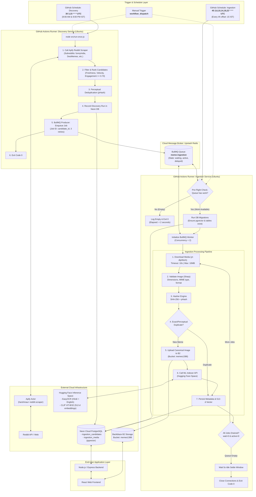
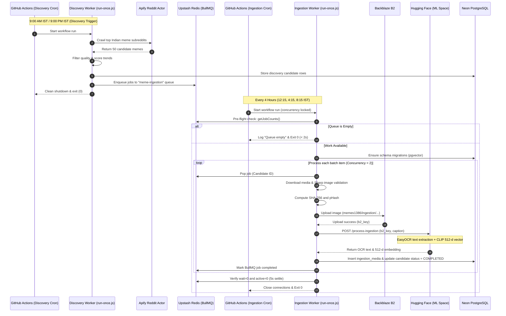

# MemeSearch: Discovery to Ingestion Workflow Architecture

This document visualizes the complete end-to-end automation pipeline connecting Reddit Discovery to MemeSearch Ingestion via GitHub Actions, Upstash Redis, Neon PostgreSQL, Backblaze B2, and Hugging Face.

---

## 1. High-Level System Architecture & Interconnection

---

## 2. Sequence of Execution Over Time

---

## 3. Data Transformation Pipeline

| Stage | Input | Component | Output | Target Storage |
| :--- | :--- | :--- | :--- | :--- |
| **1. Discovery** | Subreddit posts | Apify Scraper | JSON metadata (title, URL, upvotes) | Neon DB (`discovery_candidates`) |
| **2. Enqueue** | Candidate metadata | BullMQ Producer | Queue Job with ID = `candidate_id` | Upstash Redis (`meme-ingestion`) |
| **3. Validation** | Media URL | HTTP fetch + Sharp | Validated image buffer (dimensions, JPEG/PNG) | In-memory Buffer |
| **4. Fingerprint** | Image Buffer | Crypto + pHash | `sha256_hash` + `phash` | Neon DB (`ingestion_media`) |
| **5. Storage** | Image Buffer | Backblaze B2 SDK | B2 Object Key (e.g., `ingestion/title_hash.jpg`) | Backblaze B2 (`memes1386`) |
| **6. Machine Learning**| B2 Object Key | Hugging Face Space | OCR text + 512-dimensional CLIP embedding | Neon DB (`vector(512)`) |
| **7. Final State** | Processing summary | Worker | Status `COMPLETED`, timestamp `ingested_at` | Neon DB (`ingestion_candidates`) |
